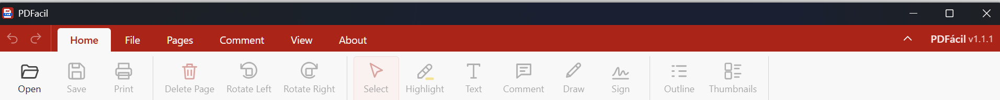

# PDFacil

This is a PDF viewer designed for researchers who read papers in PDF format.
The Home menu on top has all the tools one needs:

(fácil: 'easy', in Spanish)




## Installation on Windows

1. Download the zip file from https://urisohn.com/sohn_files/software/PDFacil.zip
2. Unzip it
3. No install, just use it running `PDFacil.exe`

**On a Mac?** The zip is for Windows only, so build PDFacil from source instead (see next). It takes a few minutes and needs no programming.


### Build from source (Mac or Windows)

You need [Node.js](https://nodejs.org/) 20 or newer, and git. On a Mac, the first time you type `git`, macOS offers to install it; click **Install**.

Open Terminal (Mac) or Command Prompt (Windows) and run:

```
git clone https://github.com/urisohn/PDFacil.git
cd PDFacil
npm install       # installs dependencies and copies the PDF libraries into src/vendor
npm start         # optional: runs the app right away, for a quick try
npm run dist      # builds the app for your computer
```

Where the finished app ends up:

- **Mac:** `dist/mac-arm64/PDFacil.app` on Apple Silicon Macs (M1 and newer), or `dist/mac/PDFacil.app` on Intel Macs. Drag `PDFacil.app` into your Applications folder. To open PDFs with it by default, select any PDF in Finder, choose **File > Get Info**, pick PDFacil under **Open with**, and click **Change All**.
- **Windows:** the `dist/win-unpacked` folder; run `PDFacil.exe` inside it.

To have `npm run dist` also copy the app to another folder, set the `PDFACIL_OUT` environment variable to that folder first (on a Mac, for example, `PDFACIL_OUT=/Applications npm run dist`). Close PDFacil before rebuilding, so the old files are not locked.

If macOS refuses to open the app you built ("damaged" or "cannot be opened"), run this once in Terminal, from the PDFacil folder:

```
codesign --force --deep --sign - dist/mac-arm64/PDFacil.app
```

## How it was made

PDFacil was designed by Uri Simonsohn and written with Claude Opus 5.5 (Anthropic's AI model). 
Version 1.0.0 was developed in November, 2026

It is built on open-source components:

- [Electron](https://www.electronjs.org/) for the desktop app
- [PDF.js](https://mozilla.github.io/pdf.js/) (Mozilla) for displaying, searching and printing PDFs
- [pdf-lib](https://pdf-lib.js.org/) for saving edits into the PDF


## License

PDFacil is licensed under [CC BY-NC 4.0](https://creativecommons.org/licenses/by-nc/4.0/): you may share and adapt it for non-commercial purposes, with credit to the author. Commercial use is not permitted.

The components it builds on have their own open-source licenses: Electron (MIT), PDF.js (Apache 2.0) and pdf-lib (MIT).
